# T3 Code Themes

21 themes for [T3 Code](https://github.com/pingdotgg/t3code). Each one puts a scene behind the whole window and turns the sidebar, chat bar, popups, Settings and panels into frosted glass in its colours. Every surface has been checked in the real app.

**Needs T3 Code v0.1.10 or newer** (custom theme CSS shipped in v0.1.10).

## Install

1. **[Download all themes (.zip)](https://github.com/burntcookiedough/t3code-themes/releases/latest/download/t3code-themes.zip)** and unzip it, or download a single theme from the gallery below.
2. In T3 Code, open **Settings → Appearance → Add theme**.
3. Drop one or more `.json` files into the dialog. Pick the theme under **Themes**.

Or from a terminal: `t3 theme set path/to/theme.json`.

**Light themes** show when **Color scheme** is Light, or System on a light computer. Dark themes show when it's Dark or System on a dark computer. Paired themes (Halftone Dawn and Halftone Dusk, for example) work well as your light and dark choice with Color scheme set to System.

## Let your coding agent do it

Paste one of these into Claude Code, Codex or any agent inside T3 Code. Both point the agent at [AGENTS.md](AGENTS.md), which has step-by-step playbooks.

**Install themes:**

```text
Install T3 Code themes for me from https://github.com/burntcookiedough/t3code-themes.
Read https://raw.githubusercontent.com/burntcookiedough/t3code-themes/main/AGENTS.md and follow
"Playbook 1: install themes" from start to finish.
The themes I want: <names from the gallery, a description of the look I like, or "all of them">.
When you're done, tell me which theme is showing and how to switch between them.
```

**Make your own theme:**

```text
Make me a custom T3 Code theme. Clone https://github.com/burntcookiedough/t3code-themes and follow
"Playbook 2: make a new theme" in its AGENTS.md from start to finish: agree on the look with me,
generate it with tools/new_theme.py, fix anything its checks reject, install it, and tell me what to
look at to judge it.
The look I want: <dark or light, the colours and mood, and any picture to show behind the app>.
```

## Soft Bloom

<table>
<tr><td width="50%" valign="top"><a href="screenshots/soft-bloom.webp">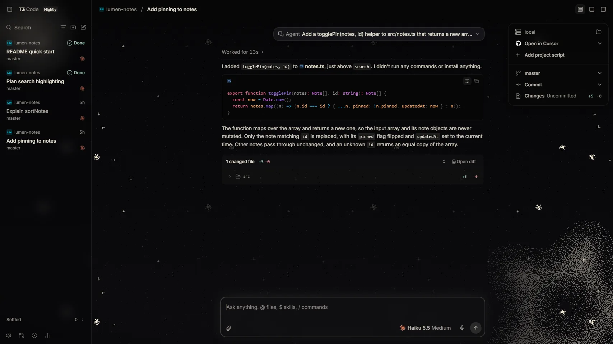</a><br><b>Soft Bloom</b> · Dark · <a href="https://github.com/burntcookiedough/t3code-themes/releases/latest/download/soft-bloom.json">Download</a> · <a href="docs/GALLERY.md#soft-bloom">More screens</a><br><sub>Very dark and dreamy: a dithered star glow and pixel sparkles behind frosted glass, with cream accents.</sub></td></tr>
</table>

## Scenes: dark

Twenty scenes from Anthropic's [theme-examples](https://github.com/anthropics/claude-plugins-official/tree/main/plugins/theme-examples) plugin for Claude Code, made into T3 Code themes (Apache-2.0, not made or endorsed by Anthropic). They're still pictures: in T3, anything moving behind the frosted glass makes the app lag.

<table>
<tr><td width="50%" valign="top"><a href="screenshots/aurora.webp">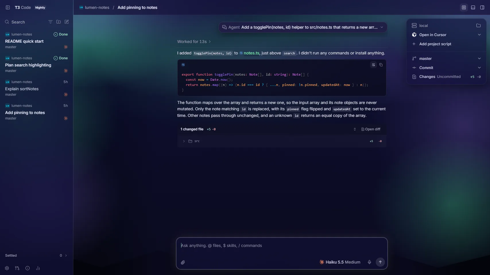</a><br><b>Aurora</b> · Dark · <a href="https://github.com/burntcookiedough/t3code-themes/releases/latest/download/aurora.json">Download</a> · <a href="docs/GALLERY.md#aurora">More screens</a><br><sub>Green and violet northern lights over a dark ridge.</sub></td><td width="50%" valign="top"><a href="screenshots/blueprint.webp">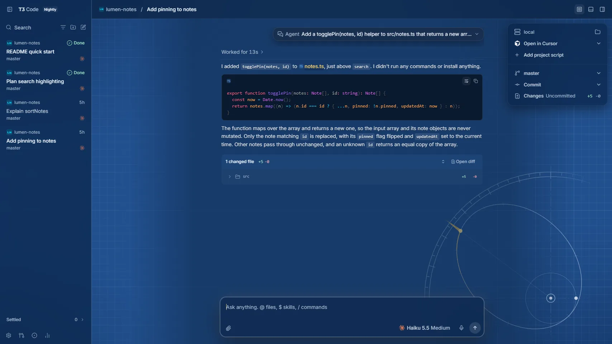</a><br><b>Blueprint</b> · Dark · <a href="https://github.com/burntcookiedough/t3code-themes/releases/latest/download/blueprint.json">Download</a> · <a href="docs/GALLERY.md#blueprint">More screens</a><br><sub>A cyanotype sheet with a plotted comet orbit in the corner.</sub></td></tr>
<tr><td width="50%" valign="top"><a href="screenshots/braille-stars.webp">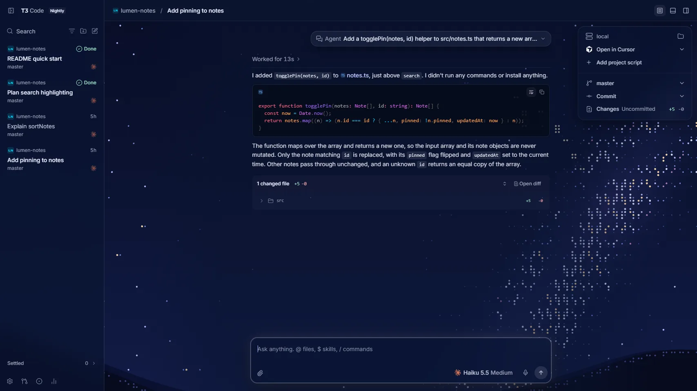</a><br><b>Braille Stars</b> · Dark · <a href="https://github.com/burntcookiedough/t3code-themes/releases/latest/download/braille-stars.json">Download</a> · <a href="docs/GALLERY.md#braille-stars">More screens</a><br><sub>A night sky and a Milky Way drawn in braille dots.</sub></td><td width="50%" valign="top"><a href="screenshots/deep-water.webp">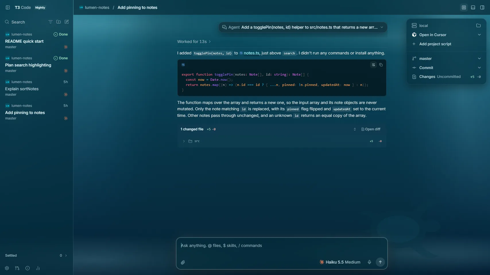</a><br><b>Deep Water</b> · Dark · <a href="https://github.com/burntcookiedough/t3code-themes/releases/latest/download/deep-water.json">Download</a> · <a href="docs/GALLERY.md#deep-water">More screens</a><br><sub>Light falling through deep teal water, a turtle's shadow below.</sub></td></tr>
<tr><td width="50%" valign="top"><a href="screenshots/departure-board.webp">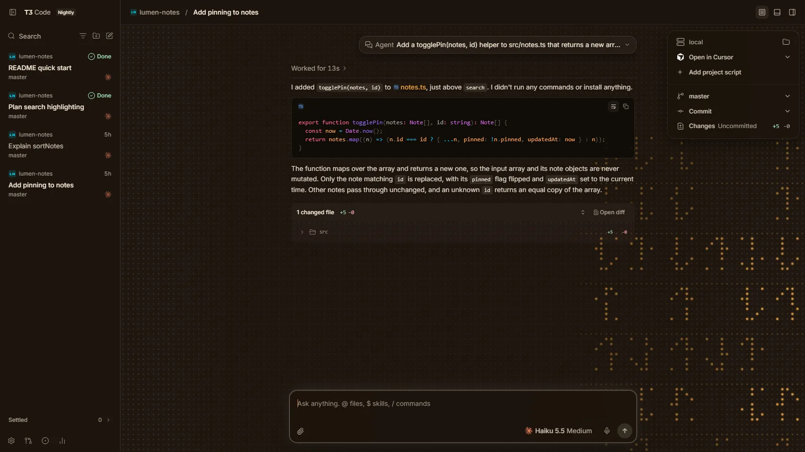</a><br><b>Departure Board</b> · Dark · <a href="https://github.com/burntcookiedough/t3code-themes/releases/latest/download/departure-board.json">Download</a> · <a href="docs/GALLERY.md#departure-board">More screens</a><br><sub>Amber LED letters on a dark board.</sub></td><td width="50%" valign="top"><a href="screenshots/dither-dunes-night.webp">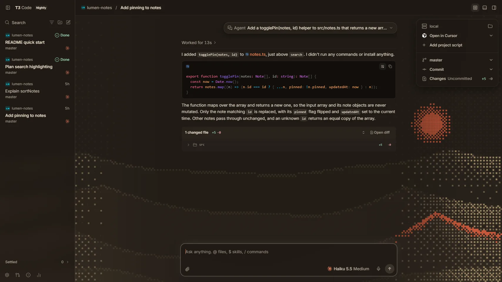</a><br><b>Dither Dunes Night</b> · Dark · <a href="https://github.com/burntcookiedough/t3code-themes/releases/latest/download/dither-dunes-night.json">Download</a> · <a href="docs/GALLERY.md#dither-dunes-night">More screens</a><br><sub>The same dunes after dark: pale dots on umber and an ember sun.</sub></td></tr>
<tr><td width="50%" valign="top"><a href="screenshots/ember-glow.webp">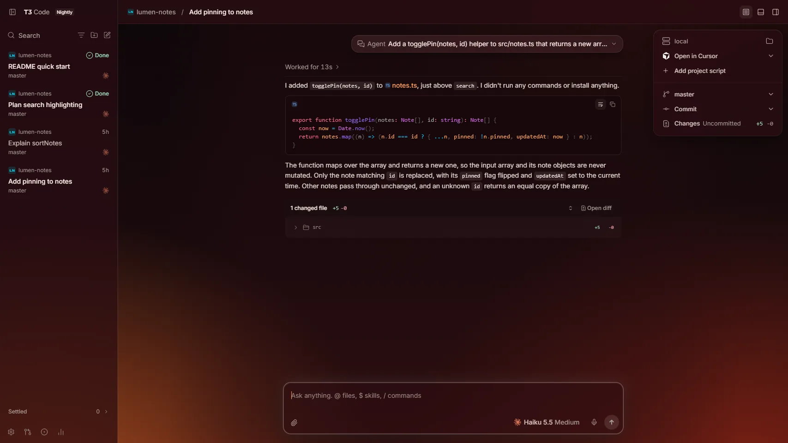</a><br><b>Ember Glow</b> · Dark · <a href="https://github.com/burntcookiedough/t3code-themes/releases/latest/download/ember-glow.json">Download</a> · <a href="docs/GALLERY.md#ember-glow">More screens</a><br><sub>A warm red glow rising from the corners of a dark room.</sub></td><td width="50%" valign="top"><a href="screenshots/halftone-dusk.webp">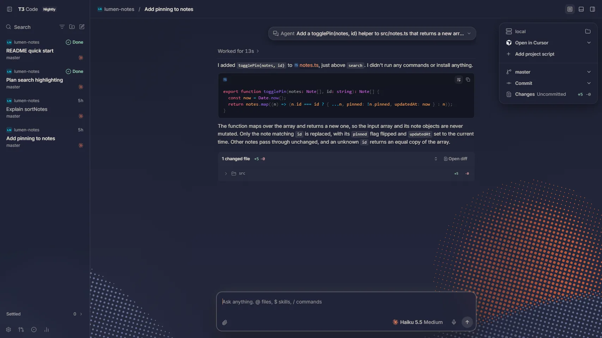</a><br><b>Halftone Dusk</b> · Dark · <a href="https://github.com/burntcookiedough/t3code-themes/releases/latest/download/halftone-dusk.json">Download</a> · <a href="docs/GALLERY.md#halftone-dusk">More screens</a><br><sub>The riso sunrise on night-blue paper: an ember sun in dots.</sub></td></tr>
<tr><td width="50%" valign="top"><a href="screenshots/night-reef.webp">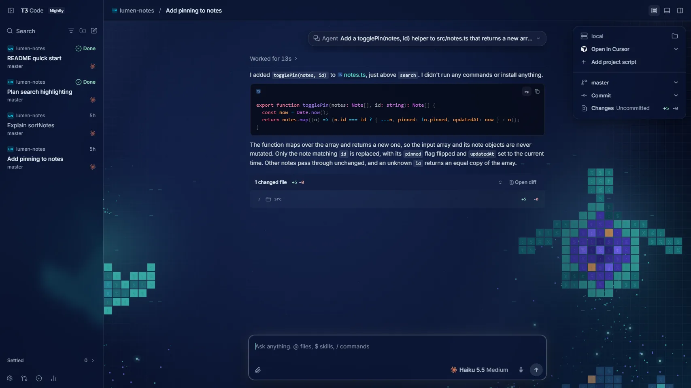</a><br><b>Night Reef</b> · Dark · <a href="https://github.com/burntcookiedough/t3code-themes/releases/latest/download/night-reef.json">Download</a> · <a href="docs/GALLERY.md#night-reef">More screens</a><br><sub>A night reef with a glowing tile turtle and ray.</sub></td><td width="50%" valign="top"><a href="screenshots/paper-garden-kraft.webp">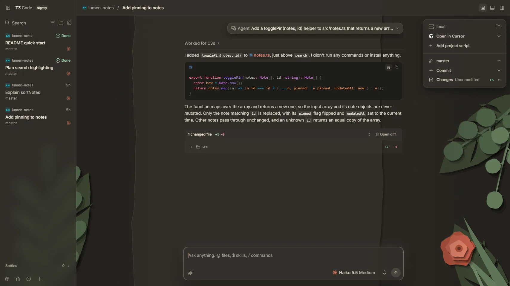</a><br><b>Paper Garden, Kraft</b> · Dark · <a href="https://github.com/burntcookiedough/t3code-themes/releases/latest/download/paper-garden-kraft.json">Download</a> · <a href="docs/GALLERY.md#paper-garden-kraft">More screens</a><br><sub>Cut-paper leaves on dark kraft paper, one coral bloom.</sub></td></tr>
<tr><td width="50%" valign="top"><a href="screenshots/plotter-tide-night.webp">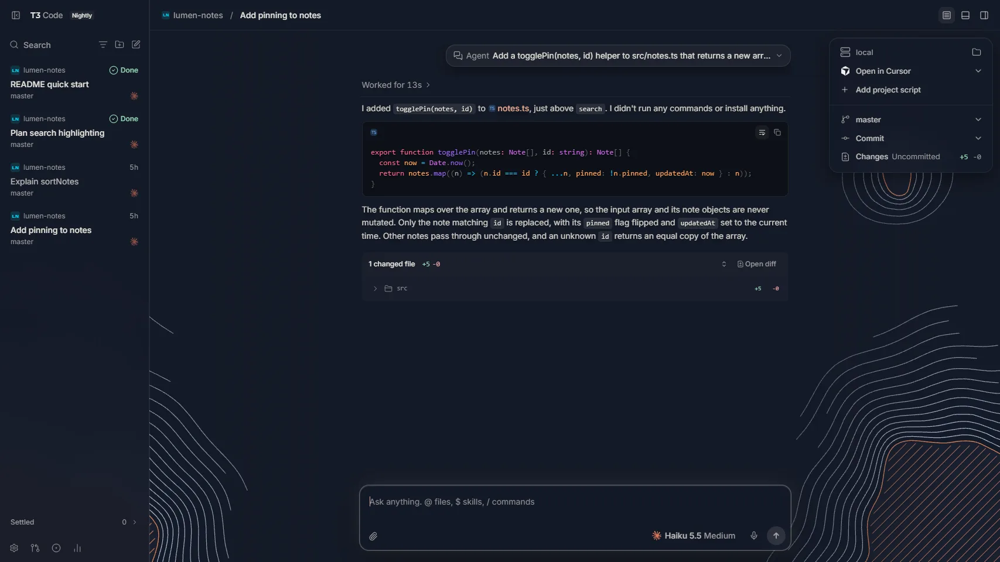</a><br><b>Plotter Tide, Night</b> · Dark · <a href="https://github.com/burntcookiedough/t3code-themes/releases/latest/download/plotter-tide-night.json">Download</a> · <a href="docs/GALLERY.md#plotter-tide-night">More screens</a><br><sub>The plotter's tide chart in pale ink on blue-black paper.</sub></td><td width="50%" valign="top"><a href="screenshots/snow-pines.webp">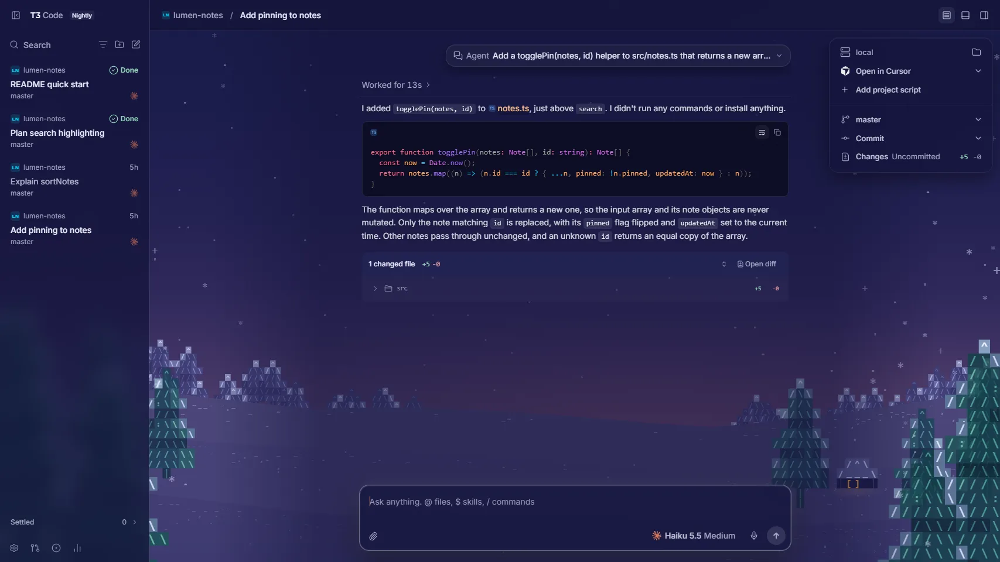</a><br><b>Snow Pines</b> · Dark · <a href="https://github.com/burntcookiedough/t3code-themes/releases/latest/download/snow-pines.json">Download</a> · <a href="docs/GALLERY.md#snow-pines">More screens</a><br><sub>An ASCII pine forest at dusk under falling snow.</sub></td></tr>
<tr><td width="50%" valign="top"><a href="screenshots/teletext-clouds.webp">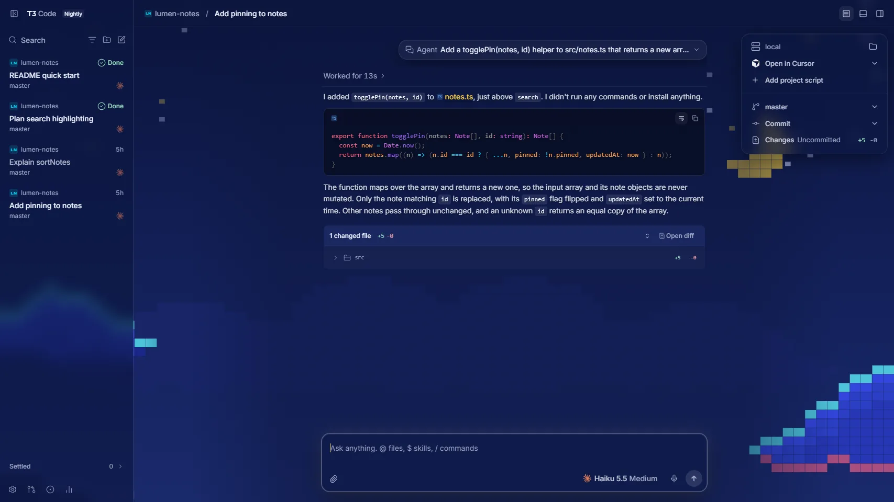</a><br><b>Block Clouds</b> · Dark · <a href="https://github.com/burntcookiedough/t3code-themes/releases/latest/download/teletext-clouds.json">Download</a> · <a href="docs/GALLERY.md#teletext-clouds">More screens</a><br><sub>Night clouds and a crescent moon built from teletext blocks.</sub></td><td width="50%" valign="top"><a href="screenshots/vector-range.webp">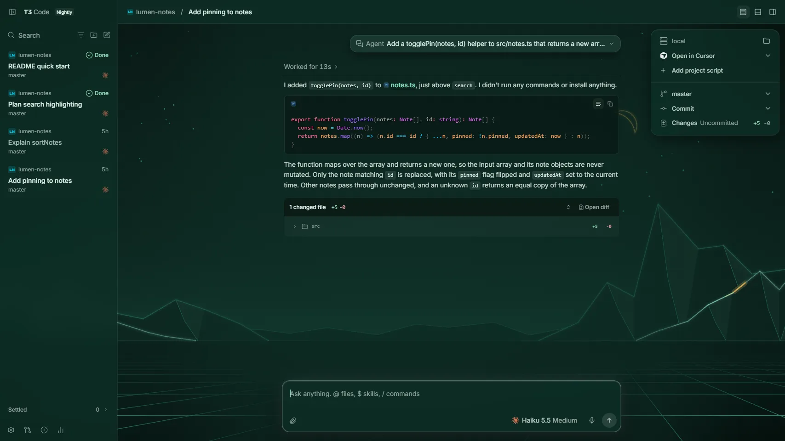</a><br><b>Vector Range</b> · Dark · <a href="https://github.com/burntcookiedough/t3code-themes/releases/latest/download/vector-range.json">Download</a> · <a href="docs/GALLERY.md#vector-range">More screens</a><br><sub>Phosphor-green wireframe mountains on black.</sub></td></tr>
</table>

## Scenes: light

<table>
<tr><td width="50%" valign="top"><a href="screenshots/dither-dunes.webp">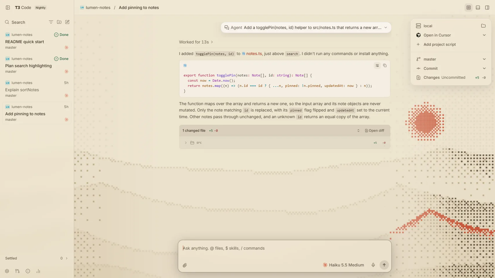</a><br><b>Dither Dunes</b> · Light · <a href="https://github.com/burntcookiedough/t3code-themes/releases/latest/download/dither-dunes.json">Download</a> · <a href="docs/GALLERY.md#dither-dunes">More screens</a><br><sub>One-bit dunes in sand-coloured dots under a terracotta sun.</sub></td><td width="50%" valign="top"><a href="screenshots/halftone-dawn.webp">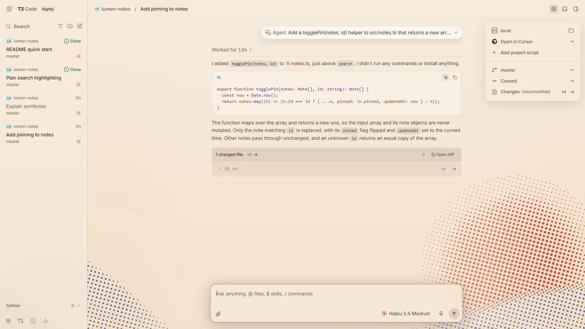</a><br><b>Halftone Dawn</b> · Light · <a href="https://github.com/burntcookiedough/t3code-themes/releases/latest/download/halftone-dawn.json">Download</a> · <a href="docs/GALLERY.md#halftone-dawn">More screens</a><br><sub>A two-ink riso sunrise in halftone dots on cream paper.</sub></td></tr>
<tr><td width="50%" valign="top"><a href="screenshots/honu-lagoon.webp">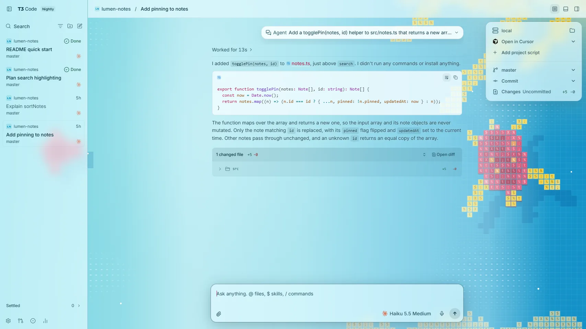</a><br><b>Honu Lagoon</b> · Light · <a href="https://github.com/burntcookiedough/t3code-themes/releases/latest/download/honu-lagoon.json">Download</a> · <a href="docs/GALLERY.md#honu-lagoon">More screens</a><br><sub>A lagoon from above in ASCII tiles, with a coral-pink turtle.</sub></td><td width="50%" valign="top"><a href="screenshots/koi-mosaic.webp">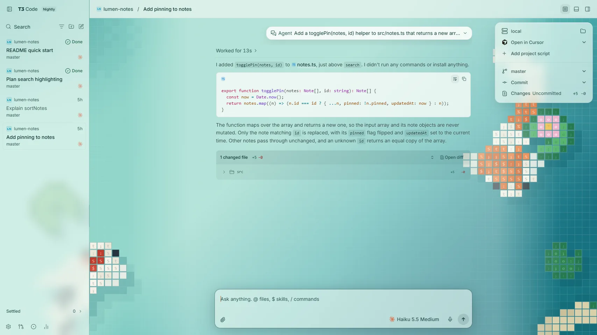</a><br><b>Koi Mosaic</b> · Light · <a href="https://github.com/burntcookiedough/t3code-themes/releases/latest/download/koi-mosaic.json">Download</a> · <a href="docs/GALLERY.md#koi-mosaic">More screens</a><br><sub>A tiled koi pond from above: two koi and lily pads.</sub></td></tr>
<tr><td width="50%" valign="top"><a href="screenshots/paper-garden.webp">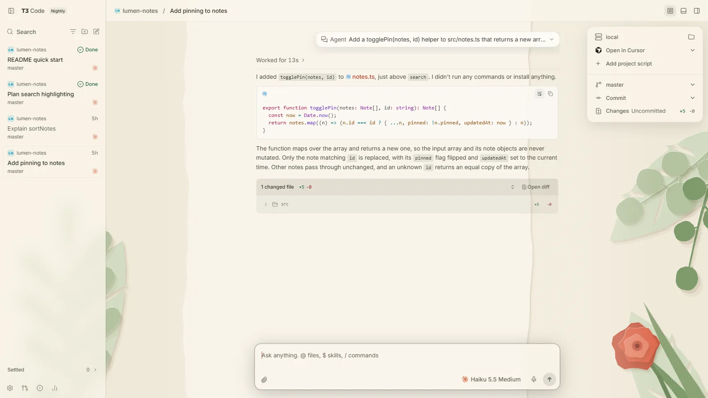</a><br><b>Paper Garden</b> · Light · <a href="https://github.com/burntcookiedough/t3code-themes/releases/latest/download/paper-garden.json">Download</a> · <a href="docs/GALLERY.md#paper-garden">More screens</a><br><sub>Cut-paper leaves at the edges of a warm white sheet, one coral bloom.</sub></td><td width="50%" valign="top"><a href="screenshots/plotter-tide.webp">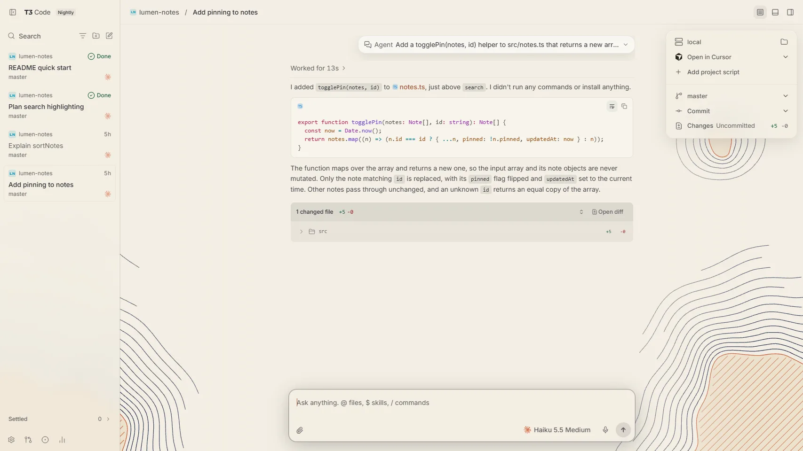</a><br><b>Plotter Tide</b> · Light · <a href="https://github.com/burntcookiedough/t3code-themes/releases/latest/download/plotter-tide.json">Download</a> · <a href="docs/GALLERY.md#plotter-tide">More screens</a><br><sub>Pen-plotter tide lines on warm paper.</sub></td></tr>
</table>

## Make your own

Everything we learned building these is written down, so you or your coding agent can start without rediscovering it:

- **[docs/THEME-GUIDE.md](docs/THEME-GUIDE.md)** covers the theme format, every colour role and what it paints, what theme CSS may contain, stable selectors, the glass recipe, the surfaces to check, performance rules and known pitfalls.
- **[AGENTS.md](AGENTS.md)** has playbooks for coding agents: install themes, make a new one, change one here, verify on every surface. `themes.json` lists every theme for them.
- **[tools/new_theme.py](tools/new_theme.py)** makes a complete theme from a background, accent and text colour, plus optional art, with the same glass treatment and checks as these.
- **[tools/capture](tools/capture/)** screenshots every surface of T3 under each theme and flags colours that don't belong.

To regenerate the themes:

```sh
python source/soft-bloom/generate.py themes/soft-bloom.json   # Soft Bloom
python source/theme-examples/build.py                         # the 20 scenes (needs Node 22.6+)
python tools/make_readme.py                                   # this README, the gallery, themes.json
```

## License

Soft Bloom, the tools and the docs are [MIT](LICENSE). The twenty scene themes and the plugin code they come from are Apache-2.0; see [NOTICE](NOTICE). This project isn't affiliated with T3 Code or Anthropic.
